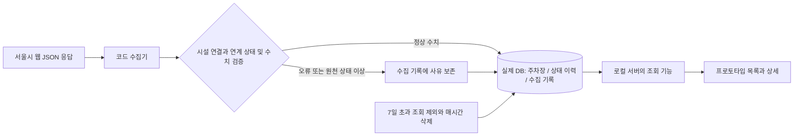

# 실데이터 수집·DB 구축·프로토타입 연결 설계

> **2026-10-23 01:35 KST 최신 상태:** 실제 DB 대상 15곳, 네이버 지도·지번 일치 좌표 15곳 연결. 01:25 수집은 정상 10/미제공 5, 01:35는 정상 8/미제공 7이었다. 01:00 매시간 7일 정리 작업의 성공 로그를 확인했다(실제 만료 삭제 사례는 아직 없음). 공식 확인 상품은 팩토리얼 2개·무신사S1 1개를 10/23 조건으로 연결했다. 기본 화면은 실데이터 전용이다. 아래의 실제 4곳/가상 지도/더미 기본 설명은 이전 단계 기록이며 [현재 실행 안내](../../prototype/README.md)가 우선한다. 이후 목적지 기준 직선거리와 공식 상품 4시설·6개 연결을 추가했다. 미확인 시설의 상품은 만들지 않는다.

기준일: 2026-10-23. 최신 상태: **Supabase 세 테이블 생성·제약 검사 완료 / 서버 함수 배포·일회 자동 수집 및 저장 성공 / 5분 수집·매시간 7일 정리 예약 활성화 / 첫 예약 수집·저장 확인 / 실제 4곳의 목록·상세 화면 연결 확인**.

사용자가 ‘DB 설계는 이미 했으니까’라고 확인했다. 기존 설계는 재검토 과제로 되돌리지 않는다. 아래 구현 순서와 당시 대안은 진행 근거이며, DB 제품과 원천 상태 결과·갤러리아포레 선택은 이미 확정됐다. [실제 구축 파일·기록](../../supabase/README.md)을 따른다.

## 1. 최신 요청과 진행 기준

사용자는 수연이 실시간 주차 데이터 구현을 요청했다고 알렸다. 코드 방식을 먼저 시도하고,
실제 DB 생성까지 설계에 포함하도록 요청했다. 이어 ‘한 번 실제 값을 가져오는가’부터 검증하는 순서를 승인했다.
과거 ‘실제 수집·DB 보류’는 현재 전체 목표를 설명하는 문구로 사용하지 않는다.
다만 DB 제품·운영 위치 등 이번 문서의 새 선택까지 승인됐다고 처리하지 않는다.

전체 구축은 아래 5개 단계로 나눈다. 문서 작성이나 UI 수정만으로 구축 진척을 올리지 않는다.

| 순서 | 할 일 | 왜 먼저 하는가 | 완료 기준 | 현재 |
| --- | --- | --- | --- | --- |
| 1 | 코드로 실제 응답 조회 | 가져올 수 없는 데이터를 전제로 DB·화면을 완성하지 않기 위해 | 출처·원본 필드·실제 수치·시각·상태 코드 확인 | 일회 가능성 검증 완료. 시설 연결은 후보 상태 |
| 2 | 실제 DB 생성 | 읽은 값을 잃지 않고 기록·조회하기 위해 | 테이블·제약 생성, 연결 등록 검토, 실제 값 저장·재조회 | Supabase 생성·실제값 4곳 첫 저장, 제약 10개 PASS. 팀 실행 확인은 별도 |
| 3 | 반복 수집과 7일 정리 | 사용자가 열 때마다 과거 고정값만 보지 않도록 | 서로 다른 실행의 이력, 실패 기록, 중복 방지·재시도·만료 정리 증거 | 서버 함수·정리 RPC 구현, 로컬 10개·실DB 7개 검사 PASS. 예약 활성화·첫 예약 수집 저장 확인. 매시간 정리의 첫 정각 실행은 미확인 |
| 4 | 웹 조회와 프로토타입 연결 | DB에만 있는 값을 사용자가 보게 하기 위해 | 실제 조회 시각으로 목록·상세 동일 데이터 표시, 더미와 구분 | 실제 4곳 목록·상세 확인. 더미 15개 유지, 읽기 실패/복구·전환 검증 |
| 5 | 팀 실행·수연 검토 | AI 환경에서만 되는 결과를 팀이 재현하도록 | 유미·종현 실행, 수연 검토, 정상·예외 결과 기록 | 미실행 |

1·2단계 결과는 서비스의 지속적인 ‘실시간 운영’ 완료가 아니다. 사용자가 준비한 Supabase DB를 사용했으며 별도 유료 서버·공개 앱 배포·반복 작업은 생성하지 않았다.

## 2. 이번에 실제 확인한 것

- 출처: [서울시 주차정보안내시스템](https://parking.seoul.go.kr/).
- 공개 화면이 불러오는 `parkingSearchPc.js`에서 검색 요청 형식과 표시 조건을 확인했다.
- `POST /search/parking/list.do`로 강변 검색 1회, 성수동1가·2가 목록 각 1회 조회했다. 전용 공개 Open API와는 다른 **웹사이트용 JSON 조회 경로**다.
- 별도 로그인·API 키 없이 이번 요청은 성공했다. 향후 접근·응답 구조·안정성이 보장된 공식 연동 계약으로 해석하지 않는다.
- 지역 목록은 각각 49·60행을 반환했다. 해당 동 밖의 주소도 섞여 있어 **응답의 실제 주소**를 다시 검사했다.
- 15개 대상 모두 주소 기준 후보가 나왔다. 14개 주소는 후보 1개, 갤러리아포레는 아파트·상가 2개다. 동일 시설 확정 등록은 아직 하지 않았다.
- 상가 후보를 기준으로 보면 정상 상태 13개, `que_status=2/3`인 후보 2개다. 해당 시점의 관찰이며 항상 같은 상태가 아니다.
- 강변은 첫 응답에서 정보 수집 중이었다가 뒤의 지역 응답에서는 정상 수치가 왔다. 시설별 상태도 요청마다 바뀔 수 있다.
- 원천 시각 문자열에 시간대 표시가 없다. 이번 검증은 서울 서비스 맥락상 **KST 가정**으로 UTC 변환했다. 서버 설정·원천 설명 확인을 구축 점검 항목으로 남긴다.

[일회 관찰 기록](../../research/source-observations/seoul-code-probe-2026-10-22.md),
[최소 필드 응답 증거](../../research/source-observations/seoul-code-probe-2026-10-22.json),
[일회 검증 코드](../../scripts/probe_seoul_parking.py).

## 3. 원천 필드 → 우리 컬럼

원천에는 ‘가능 면수’ 대신 전체와 현재 주차 대수가 있어 뺄셈으로 계산한다.

| 원천 이름 | 관찰한 의미 | 우리 항목 | 처리 |
| --- | --- | --- | --- |
| `parking_code` | 주차장 코드 | `source_parking_id` | 이름·주소·시설 구분 검토 후 등록. 우리 UUID와 별개 |
| `parking_name` / `address` | 제공처 이름·주소 | 기본정보 대조 근거 | 사용자 제공 원문을 자동 덮어쓰지 않음 |
| `capacity` | 전체 면수(문자 형태 숫자) | `total_spaces` | 정수, 1 이상 검증 |
| `cur_parking` | 현재 주차 대수(가능 면수 아님) | 계산 입력 | 정수, 0 이상·전체 이하 검증 |
| `capacity - cur_parking` | 우리가 계산한 가능 면수 | `available_spaces` | 원천 연계 상태가 정상일 때만 계산·저장 |
| `cur_parking_time` | 주차 현황의 시각 | `source_updated_at` | 없으면 NULL, 잘못된/미래 시각이면 정상 이력 제외 |
| `sync_time` | 시설정보 수정일 계열 값 | 상태 시각에 사용하지 않음 | 기존 화면의 정보 등록(수정)일자와 대조 |
| `que_status` | 현황 연계·표시 상태 코드 | 수집 적격성 판정 | 정상 1만 상태 수치 처리. 나머지는 아래 정책 |
| `que_status_nm` | 관찰된 시간 구간 설명(20분/2시간/2일 등) | 진단 근거 | 수집 주기나 수치의 신뢰성 보장으로 해석하지 않음 |
| 원천에 없음 | 우리 요청/응답 시각 | `started_at` / `finished_at` / `collected_at` | 우리 코드가 UTC로 기록. 원천 시각 대체 금지 |

공식 사이트의 공개 표시 코드에서는 0=기본정보, 2=정보수집중, 3=통신점검중으로 분기한다.
이번 정상 응답은 1이었다. 모르는 코드가 나오면 정상으로 추정하지 않는다.
원천 사이트는 음수 가능 면수를 0으로 보정하지만, 우리 기존 합의는 잘못된 수치를 오류로 남기는 것이다. **우리 수집에서는 조용히 0으로 보정하지 않는다.**

## 4. 실제로 만들 구조 — 제안

### DB 제품 — Supabase 확정

- 사용자는 이미 팀원을 초대한 Supabase 프로젝트를 제공했다. URL은 `https://ksuzhoeahgqbvrbchwpb.supabase.co`다. SQLite 추천은 채택되지 않았다.
- 대시보드와 읽기 전용 SQL로 PostgreSQL 17.11, UTC 시간대, 생성 전 public 테이블 0개를 확인했다.
- Supabase는 팀 공용 DB이고 수집 프로그램은 별도 실행 주체다. 공용 DB를 만든 것만으로 수집 코드가 자동 실행되지는 않는다.
- public 테이블 세 개의 RLS를 켰고 익명·로그인 사용자용 읽기/쓰기 정책은 열지 않았다. 비밀 키를 프로토타입에 넣지 않는다.
- 원격 수집기를 Supabase Edge Function과 Cron으로 실행할 수 있다. [공식 실행 예약 안내](https://supabase.com/docs/guides/functions/schedule-functions)를 확인했다. 함수 배포·일회 검증 후 사용자 A1·B1 승인에 따라 5분 수집과 매시간 만료 정리 예약도 활성화했다.

### DB 생성에 포함할 실제 작업

1. 선택한 DB 제품에 맞춘 버전 있는 생성 SQL과 초기화 명령을 준비한다. 기존 DB를 무조건 삭제·재생성하지 않는다.
2. 기존 논리 설계의 주차장 5·상태 8·수집 9개 컬럼을 실제 테이블로 만든다. 확정 물리 테이블명·자료형은 해당 단계에서 문서와 맞춘다.
3. UUID 기본키, 필수값, 수치 범위, FK를 적용한다. 선택한 PostgreSQL의 FK로 잘못된 연결 입력이 실제 거절되는지 확인한다. 실제 DB 검사에서 거절을 확인했다.
4. 상태의 `collection_attempt_id`는 NULL을 허용하되 값이 있으면 중복 불가다. 수집 기록 삭제 시 NULL로 변경한다. `retry_of_id`도 부모 삭제 시 NULL로 변경한다. 주차장 삭제는 연결 기록이 남으면 제한한다.
5. 기존 시설 UUID를 유지하고 검토한 원천 코드와 연결한다. 원천 이름 변경으로 새 시설을 자동 생성하지 않는다.
6. 성공 처리 시 상태 저장과 시도 종료 갱신을 하나의 트랜잭션(한 묶음 저장)으로 처리한다. 상태의 주차장과 수집 시도의 주차장도 일치하는지 확인한다.
7. 주차장별 수집 시작 시각·상태 수집 시각 인덱스를 준비한다. 최신값 조회와 7일 삭제에 사용한다.
8. 실제 응답을 최소 3개 시설에 저장하고 재조회한다. 프로세스를 재시작해도 남는지 확인한다. 잘못된 FK·면수·중복 시도 입력 거절과 삭제 시 연결 유지도 확인한다.

### 원천 정보 수집 중·점검 중 — SOURCE_UNAVAILABLE 확정

기존 수집 결과 코드는 진행/성공/접근 실패/검증 오류 4종이다. HTTP가 성공했지만 원천 상태가 비정상인 경우가 새로 확인됐다.

- 사용자가 1안을 선택해 `SOURCE_UNAVAILABLE`을 결과 목록에 추가했고 실제 DB CHECK에 반영했다. `error_code`로 원천 0/2/3/미정 코드를 구분하며 정상 상태 이력을 추가하지 않는 방식이다. 미정 코드는 `UNKNOWN_SOURCE_STATUS` 사유로 남긴다.
- 어느 안이든 기존 마지막 정상 기록을 현재 정보로 바꾸지 않는다. 화면은 마지막 기록 또는 확인 필요로 표시한다. `SUCCESS`로 처리해 0을 빈자리로 바꾸지 않는다.
- 기존 DB 컬럼표에 후속 확정 결과를 추가했다. 프로토타입의 실패 판정 확장도 후속으로 구현했다. SOURCE_UNAVAILABLE·IN_PROGRESS·읽기 실패에서는 현재 배지를 숨긴다.

## 5. 반복 수집 — 일회 저장이 된 다음

- 단계 2는 우선 수동 실행이다. 제품 선택이 전체 상시 운영 승인은 아니다.
- 이후 사용자가 **Supabase 실행·5분 주기**를 선택했고 무료 요금제 가능 여부를 질문했다. 공식 기능·호출 한도를 확인한 결과는 [무료 범위 계산](../../supabase/FREE_PLAN_BUDGET.md)에 기록했다. Supabase에서 일회 자동 저장이 성공한 뒤 일정을 켠다. 동 단위 배치 경로가 유지되면 1회 실행당 2개 지역 요청으로 묶을 수 있다. 함수 배포·일회 자동 저장은 성공했다. 사용자 A1·B1 승인 후 5분 수집·매시간 만료 정리 일정도 활성화했다.
- 5분 수집은 서울시가 5분마다 새 값을 보장한다는 뜻이 아니다. 갱신 시각과 20분 지연 판단을 별도로 유지한다.
- 같은 시설의 실행이 겹치지 않도록 잠근다. 배치 요청을 공유해도 알려진 시설별 수집 시도는 각각 기록한다. 대상이 이미 정해졌다면 지역 응답 실패도 해당 `parking_id`에 남긴다.
- 접근 실패만 30초 후 한 번 재시도한다. 데이터 오류·원천 점검 상태는 30초 접근 재시도의 대상이 아니다.
- 원천 값이 같아도 새 시도는 새 로그다. 하나의 시도가 두 번 저장되는 것만 막는다.
- 상태는 `collected_at`, 시도·최소 오류 원본은 `started_at` 기준 7일 초과분을 조회 제외한다. 매시간 실제 삭제하고 만료 로그의 연결 FK는 NULL로 처리한다.
- PC가 잠들거나 프로그램이 꺼지면 로컬 수집도 중단된다. 재시작 시 만료 정리와 남은 IN_PROGRESS 판정을 점검한다. 상시 서버는 별도 단계다.
- 종료된 것처럼 보이지 않는 IN_PROGRESS 타임아웃은 요청 제한·재시도 대기를 합쳐 후속 설계에서 확정한다. 현재 일회 검증의 요청 제한은 20초이며 운영 확정값이 아니다.

## 6. 화면 연결 — 더미와 실제값을 섞지 않기

- 브라우저가 외부 사이트나 DB 파일에 직접 접속하지 않고, 로컬 서버의 조회 기능을 호출하게 한다. 데이터 수집은 서버 코드가 맡는다.
- 기존 가상 데이터·고정 12:00 기준 모드는 반복 UT용으로 유지하고, **실데이터 모드**를 별도로 만든다. 실제값 실패 시 더미로 몰래 대체하지 않는다.
- 실제 모드의 `as_of`는 현재 조회 시각을 UTC로 생성한다. 기존 고정 테스트 시각으로 최신성을 판정하지 않는다.
- 목록·상세는 같은 조회 양식과 판정 함수를 사용한다. 실제 모드와 시나리오 강제 주입은 섞지 않는다.
- 실데이터 모드에서도 상품·가격·거리·지도 표식은 별도 검증 전까지 가상이다. 화면에 ‘주차 현황은 실제 수집 / 상품·가격·거리는 가상’처럼 구분한다.
- 원천 상태 이상, 시각 없음, 오래됨, 수집 실패는 배지·시각·안내를 함께 검증한다. 입차 보장·주차권 판매 가능 여부로 확대 해석하지 않는다.
- 실제값을 화면에 연결하는 날 `data_origin` 표기와 기록 구분을 정하고, 가상 구매 기록을 실제 운영 성과로 합치지 않는다.

## 7. 팀과 함께 확인할 학습 묶음 — 역할 제안

담당자를 확정하거나 Notion 속성을 변경한 표가 아니다.

| 묶음 | AI가 준비할 것 | 유미·종현이 설명하고 확인할 것 | 검토 자료 |
| --- | --- | --- | --- |
| 1: 원천 해석 | 일회 검증 코드와 필드표 | 현재 주차 대수와 가능 면수의 차이, 0이어도 정상 처리 못 하는 이유 | 이번 실제 응답 |
| 2: DB 만들기 | 생성 SQL·초기화·저장 명령 | PK/FK 연결, 실제 INSERT 후 SELECT, 재시작 후 유지 | DB 조회 결과 |
| 3: 반복과 실패 | 수집 루프·만료 정리·예외 처리 | 같은 수치의 새 시도와 중복 저장 차이, 실패 시 마지막 기록 | 이력·오류·만료 증거 |
| 4: 화면과 검토 | 서버 조회·실제/더미 분리 | 목록·상세의 시각·숫자를 DB와 대조 | 수연 검토 화면 |

## 8. 해소된 선택과 다음 결정

A. DB 시작 환경: 사용자가 준비한 Supabase PostgreSQL로 확정. 다시 묻지 않는다.

B. 원천 상태 이상 결과: 사용자 1안 선택, SOURCE_UNAVAILABLE 추가·실DB 반영 완료.

C. 갤러리아포레: 사용자 1안 선택. 원천 이름·주소·코드를 재대조해 더몰 상가 3204785를 첫 저장에 사용했다. 아파트 3147217은 연결하지 않았다.

수집 코드 실행 위치와 반복 주기도 사용자 선택으로 Supabase Edge Functions+Cron·5분으로 정했다. 무료 요금제 가능 여부를 공식 문서와 예상 사용량으로 확인했다. 배포 환경에서 일회 자동 저장은 검증했다(4곳 중 정상 3개, 원천 상태 이상 1개). 사용자가 A1·B1로 자동 호출 인증정보의 같은 프로젝트 Vault 보관과 실제 만료 삭제 일정 활성화를 승인했다. 두 Vault 항목과 예약 작업 활성화를 확인했다. 00:35 첫 예약 실행에서 HTTP 200과 DB 새 상태 3개 저장을 확인했다. 매시간 정리의 첫 정각 실행은 아직 확인 전이다. 화면은 별도 실데이터 모드로 연결·검증했고 더미 연습 모드는 유지했다. [서버 수집 인수인계](../../supabase/COLLECTION_HANDOFF.md)를 따른다.
